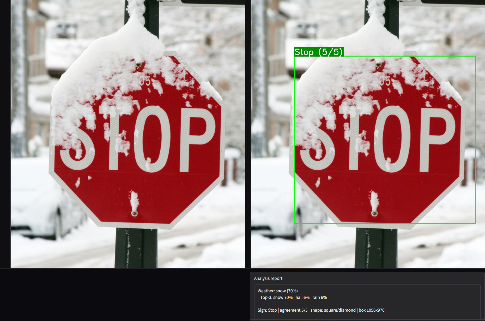
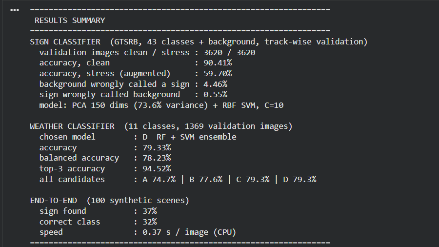
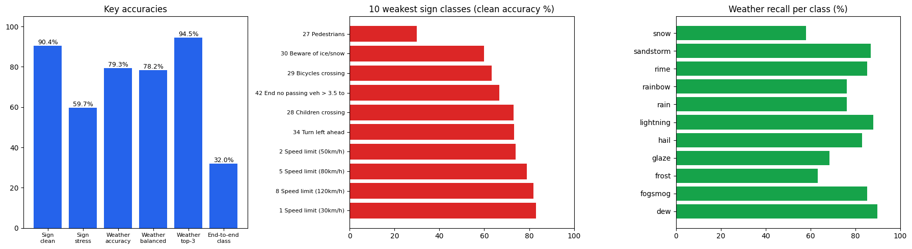
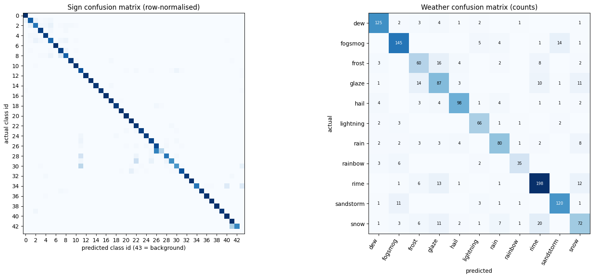
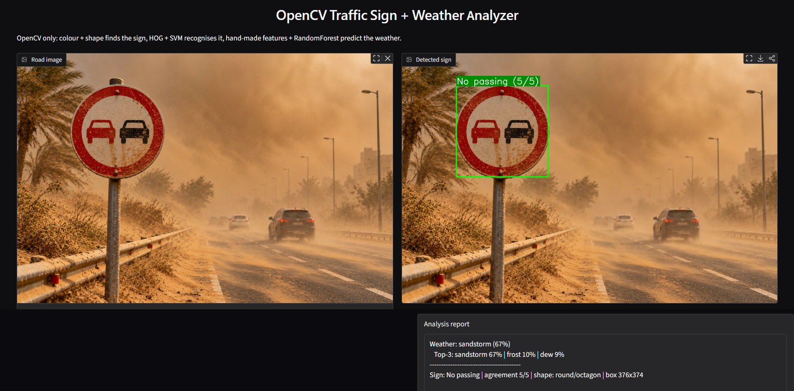
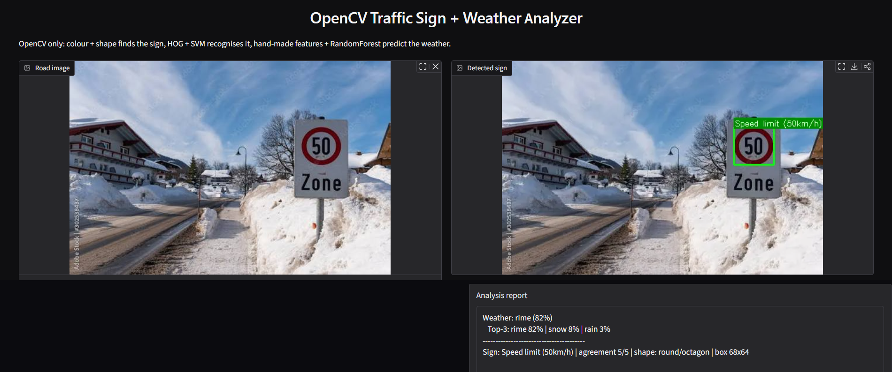
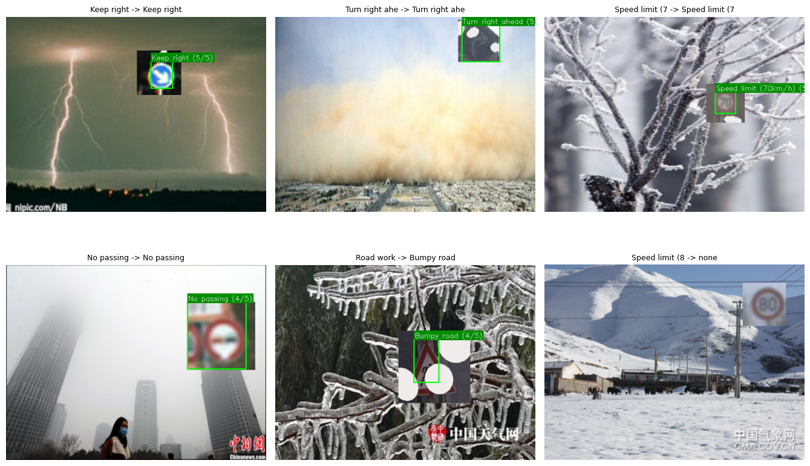

# Traffic Sign + Weather Analyzer

Classical computer vision project built with **OpenCV and NumPy only**. No TensorFlow, no PyTorch, no YOLO, no scikit-learn. Upload a road photo and the app finds the traffic sign, recognises it, and predicts the weather in the scene.

## What it does

1. **Finds the sign:** HSV colour masks (red / blue / yellow), morphology, contours and a shape filter.
2. **Recognises the sign:** HOG + colour features, PCA (2020 to 150 dimensions), RBF SVM. 43 GTSRB classes plus one background class. Five slightly different crops vote, and the vote share is shown as the "agreement" (for example 5/5).
3. **Predicts the weather:** hand-made image features (brightness, haze, Gabor texture, SIFT bag-of-visual-words, 511 features in total) feeding a RandomForest + SVM ensemble. 11 classes, top-3 predictions are reported.
4. **Gradio web UI** to upload an image and get the detected sign, a colour-mask view and a text report.

## Results

All numbers are measured on held-out validation data. The GTSRB split is done **track-wise** (all frames of one physical sign stay on the same side), so the accuracy is not inflated by near-duplicate images.

| Part | Metric | Result |
|---|---|---|
| Sign classifier | Accuracy, clean validation (3620 crops) | **90.41%** |
| Sign classifier | Accuracy, stress / augmented validation | **59.70%** |
| Sign classifier | Background wrongly called a sign | 4.46% |
| Sign classifier | Sign wrongly called background | 0.55% |
| Weather classifier | Accuracy (1369 validation images, 11 classes) | **79.33%** |
| Weather classifier | Balanced accuracy | 78.23% |
| Weather classifier | Top-3 accuracy | 94.52% |
| End-to-end (100 synthetic road scenes) | Sign found | 37% |
| End-to-end (100 synthetic road scenes) | Correct class | 32% |
| Speed | CPU only | about 0.37 s per image |

Sign SVM settings (C = 10, gamma x1) were picked from a small grid on the validation set, so the sign numbers can be slightly optimistic.

Weather models compared on the same validation images:

| Model | Accuracy | Balanced | Top-3 |
|---|---|---|---|
| A. v1 features + RandomForest | 74.7% | 72.4% | 91.8% |
| B. v2 features + RandomForest | 77.6% | 75.9% | 94.1% |
| C. v2 features + SVM | 79.3% | 78.2% | 85.3% |
| **D. RandomForest + SVM ensemble (chosen)** | **79.3%** | **78.2%** | **94.5%** |

C and D tie on accuracy, so D is chosen because of its much better top-3.

## Demo

The confidence shown in each report is the weather model's confidence for that one image, not an accuracy figure.

**No passing sign in a sandstorm**

**Speed limit 50 km/h in a rime / snow scene**

## Limitations (honest notes)

- **The sign detector is the bottleneck.** The classifier reaches 90% on clean crops, but the colour + shape detector finds the sign in only 37% of the synthetic scenes, so the end-to-end class accuracy is 32%. Better detection (for example a sliding-window or learned detector) is the most valuable next step.
- **Stress accuracy is 59.7%.** Heavy noise, blur and brightness changes hurt the hand-made HOG features. Stronger augmentation or better features would be needed to improve this.
- **Weakest sign classes:** 27 Pedestrians (30%), 30 Beware of ice/snow (60%), 29 Bicycles crossing (63%), 42 End of no passing for vehicles over 3.5 t (67%), 28 Children crossing (73%).
- **Weakest weather classes:** snow (58%), frost (63%), glaze (69%). They look similar to each other, as the confusion matrix shows.
- The end-to-end test uses synthetic scenes (signs pasted on weather photos), so real-road performance will differ.

## How to run (Google Colab)

1. Open the notebook with the Colab badge above.
2. Click **Runtime > Run all**. On a fresh Colab runtime, Cell 1 may install OpenCV 4.x and ask for one restart. Restart the session and press **Run all** again.
3. **First run (about 20 to 30 minutes, CPU is enough):** datasets are downloaded, both models are trained, accuracy is measured and everything is backed up to Google Drive.
4. **Later runs (about 1 minute):** models and metrics are restored from Drive, so training is skipped. To train again from scratch, set `FORCE_RETRAIN = True` in Cell 1.
5. The last cells start the Gradio app. The public `gradio.live` link is temporary.

Note: Cell 1 must keep OpenCV on version 4.x. OpenCV 5 does not include the SVM, RTrees and HOG modules this project uses.

## Datasets

- **GTSRB** (German Traffic Sign Recognition Benchmark), 43 sign classes. Downloaded through a Kaggle mirror, with the original server as fallback.
- **Weather image dataset** from Kaggle with 11 classes: dew, fogsmog, frost, glaze, hail, lightning, rain, rainbow, rime, sandstorm, snow.

The datasets and trained model files are not stored in this repository.

## Tech stack

Python 3, OpenCV (including contrib / SIFT), NumPy, Matplotlib, Gradio, Google Colab.

## Author

Deven Vaghela
